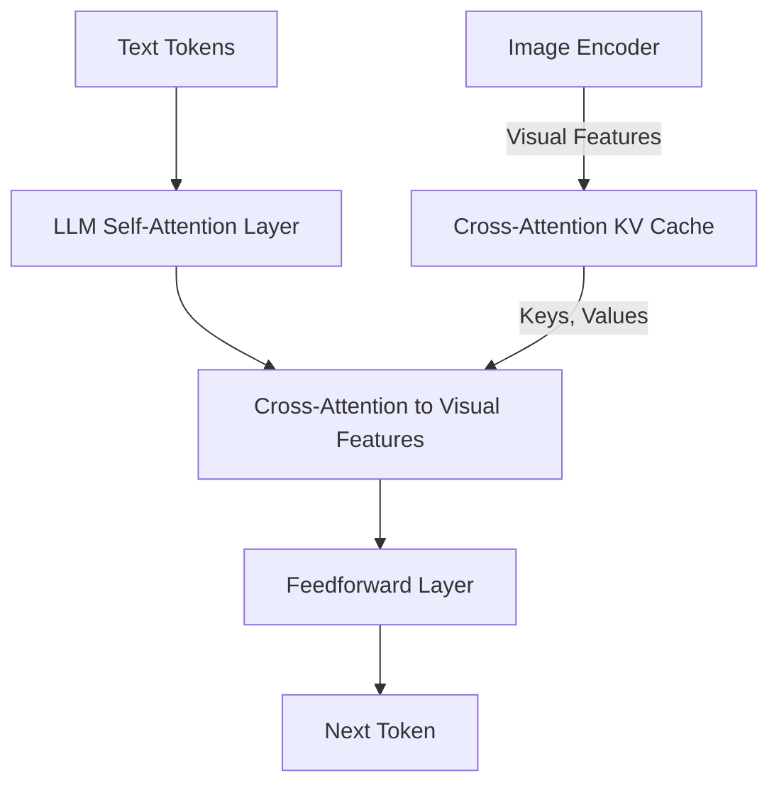
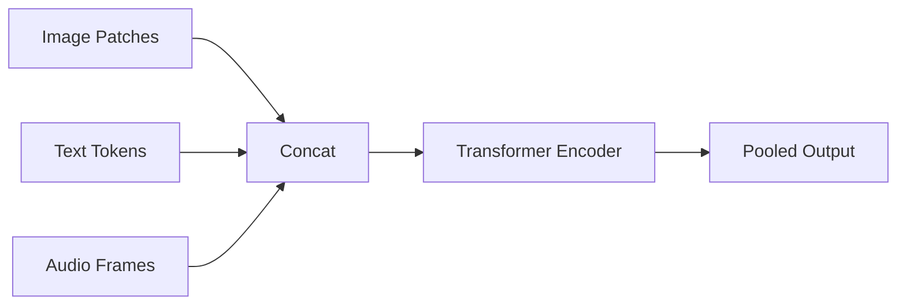
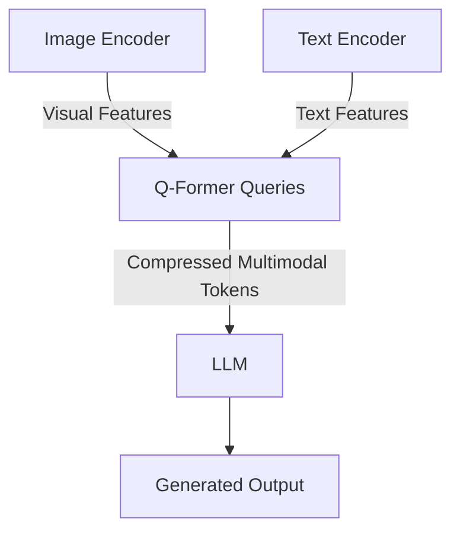

Modern AI systems don't just read text—they process images, audio, video, and combinations of all four. Behind these capabilities lies a deceptively simple idea: **embeddings**, dense vectors that represent different modalities in compatible mathematical spaces. Understanding how these embeddings are built, aligned, and fused is essential for building reliable multimodal systems.

<Callout type="info" title="What You'll Learn">
This guide covers multimodal embeddings from the ground up: how embeddings are constructed for each modality, how they're aligned (contrastive vs generative objectives), fusion patterns with diagrams, and three practical examples (two runnable, one pseudo-code).
</Callout>

## What Are Embeddings?

An **embedding** is a dense vector representation of data—whether text, images, audio, or video—in a continuous space where semantic similarity corresponds to geometric proximity. For example, the word "cat" and "kitten" should have embeddings that are close together, while "cat" and "airplane" should be far apart.

In text models, embeddings are learned through language modeling objectives. But in **multimodal systems**, we need embeddings from different modalities to live in **shared or compatible spaces**. This allows us to:

- **Retrieve images using text queries** (and vice versa)
- **Generate captions from images**
- **Answer questions about videos**
- **Search audio clips using text descriptions**

The core challenge is **modality alignment**: ensuring that semantically related inputs from different modalities (e.g., an image of a dog and the word "dog") map to nearby points in embedding space.

<Callout type="warning">
Without proper alignment, your text encoder and image encoder will live in separate universes—making cross-modal retrieval impossible.
</Callout>

## Building Embeddings for Each Modality

Different modalities require different preprocessing and embedding strategies before they can be integrated into a unified model.

### Text: Token Embeddings

Text is tokenized (split into subwords or characters), then each token is mapped to a learned embedding vector. Positional encodings are added to preserve sequence order.

```python
# Simplified text embedding
import torch
import torch.nn as nn

class TextEmbedding(nn.Module):
    def __init__(self, vocab_size=50000, embed_dim=512, max_len=512):
        super().__init__()
        self.token_embed = nn.Embedding(vocab_size, embed_dim)
        self.pos_embed = nn.Embedding(max_len, embed_dim)

    def forward(self, token_ids):
        # token_ids: [batch, seq_len]
        positions = torch.arange(token_ids.size(1), device=token_ids.device)
        return self.token_embed(token_ids) + self.pos_embed(positions)
```

**Key point:** Text embeddings are discrete tokens projected into continuous space, then enriched with positional information.

### Images: Patch Embeddings (Vision Transformers)

Following the Vision Transformer (ViT) approach [5], images are split into fixed-size patches (e.g., 16×16 pixels), flattened, and linearly projected into embedding vectors. A learnable `[CLS]` token is prepended, and 2D positional embeddings are added.

```python
class ImagePatchEmbedding(nn.Module):
    def __init__(self, img_size=224, patch_size=16, embed_dim=512, channels=3):
        super().__init__()
        self.patch_size = patch_size
        self.num_patches = (img_size // patch_size) ** 2

        # Linear projection of flattened patches
        self.proj = nn.Conv2d(channels, embed_dim, kernel_size=patch_size, stride=patch_size)
        self.cls_token = nn.Parameter(torch.zeros(1, 1, embed_dim))
        self.pos_embed = nn.Parameter(torch.zeros(1, 1 + self.num_patches, embed_dim))

    def forward(self, images):
        # images: [batch, 3, 224, 224]
        x = self.proj(images)  # [batch, embed_dim, H/P, W/P]
        x = x.flatten(2).transpose(1, 2)  # [batch, num_patches, embed_dim]

        # Prepend CLS token
        cls_tokens = self.cls_token.expand(x.size(0), -1, -1)
        x = torch.cat([cls_tokens, x], dim=1)

        # Add positional embeddings
        return x + self.pos_embed
```

**Key point:** Images become sequences of patch embeddings, making them compatible with Transformer architectures originally designed for text.

### Audio: Frame Embeddings (wav2vec 2.0)

Audio waveforms are processed as overlapping frames, typically using convolutional encoders to extract temporal features. Models like wav2vec 2.0 [6] learn representations via contrastive learning on masked frames.

```python
class AudioEmbedding(nn.Module):
    def __init__(self, sample_rate=16000, frame_len=25, frame_stride=10, embed_dim=512):
        super().__init__()
        # 1D convolution over raw waveform
        self.conv_layers = nn.Sequential(
            nn.Conv1d(1, 128, kernel_size=10, stride=5),
            nn.ReLU(),
            nn.Conv1d(128, 256, kernel_size=8, stride=4),
            nn.ReLU(),
            nn.Conv1d(256, embed_dim, kernel_size=4, stride=2),
        )
        self.pos_embed = nn.Parameter(torch.zeros(1, 1024, embed_dim))  # Max frames

    def forward(self, waveform):
        # waveform: [batch, 1, samples]
        x = self.conv_layers(waveform)  # [batch, embed_dim, frames]
        x = x.transpose(1, 2)  # [batch, frames, embed_dim]
        return x + self.pos_embed[:, :x.size(1), :]
```

**Key point:** Audio embeddings capture temporal dynamics through convolutional feature extraction, then add positional information for sequence modeling.

### Video: Spatiotemporal Tokens

Videos add a temporal dimension to images. One common approach is to extract frame embeddings independently, then add temporal positional encodings. More sophisticated methods use 3D convolutions or factorized spatiotemporal attention.

```python
class VideoEmbedding(nn.Module):
    def __init__(self, img_size=224, patch_size=16, num_frames=8, embed_dim=512):
        super().__init__()
        self.image_embed = ImagePatchEmbedding(img_size, patch_size, embed_dim)
        self.temporal_pos_embed = nn.Parameter(torch.zeros(1, num_frames, embed_dim))

    def forward(self, video):
        # video: [batch, num_frames, 3, H, W]
        batch, frames = video.size(0), video.size(1)

        # Embed each frame
        frame_embeds = []
        for t in range(frames):
            frame_embeds.append(self.image_embed(video[:, t]))  # [batch, patches+1, dim]

        x = torch.stack(frame_embeds, dim=1)  # [batch, frames, patches+1, dim]

        # Add temporal positional embeddings to CLS tokens
        x[:, :, 0, :] += self.temporal_pos_embed[:, :frames, :]
        return x.flatten(1, 2)  # [batch, frames*(patches+1), dim]
```

**Key point:** Video embeddings extend image patches with temporal structure, creating spatiotemporal token sequences.

## Projecting Modalities into LLM Space

Once you have raw embeddings, you need to **adapt** them into the embedding space of a pretrained language model (LLM). Three common strategies:

### 1. Linear Projection

The simplest approach: a learnable linear layer projects modality-specific embeddings into the LLM's embedding dimension.

```python
# Example: Project image embeddings into LLM space
image_features = vision_encoder(image)  # [batch, num_patches, 768]
llm_embeds = nn.Linear(768, llm_dim)(image_features)  # [batch, num_patches, llm_dim]
```

**Used in:** Early multimodal models, simple adapters.

**Trade-off:** Fast and parameter-efficient, but limited expressiveness.

### 2. Resampler / Q-Former (BLIP-2)

Instead of using all image patches, a **query-based resampler** compresses visual features into a fixed number of learned query tokens. The Q-Former [2] uses cross-attention between learnable queries and image features.

```python
class QFormer(nn.Module):
    def __init__(self, num_queries=32, embed_dim=768, num_heads=12, depth=6):
        super().__init__()
        self.queries = nn.Parameter(torch.zeros(1, num_queries, embed_dim))
        self.cross_attn_layers = nn.ModuleList([
            nn.MultiheadAttention(embed_dim, num_heads) for _ in range(depth)
        ])
        self.ffn_layers = nn.ModuleList([
            nn.Sequential(nn.Linear(embed_dim, 4*embed_dim), nn.GELU(),
                         nn.Linear(4*embed_dim, embed_dim)) for _ in range(depth)
        ])

    def forward(self, image_features):
        # image_features: [batch, num_patches, embed_dim]
        batch_size = image_features.size(0)
        queries = self.queries.expand(batch_size, -1, -1)

        for cross_attn, ffn in zip(self.cross_attn_layers, self.ffn_layers):
            # Cross-attention: queries attend to image features
            queries_out, _ = cross_attn(queries.transpose(0,1),
                                       image_features.transpose(0,1),
                                       image_features.transpose(0,1))
            queries = queries + queries_out.transpose(0,1)
            queries = queries + ffn(queries)

        return queries  # [batch, num_queries, embed_dim] - compressed representation
```

**Used in:** BLIP-2 [2], InstructBLIP.

**Trade-off:** More expressive than linear projection, but adds trainable parameters and computation.

### 3. Cross-Attention Memory (Flamingo)

Image features are stored as key-value pairs in cross-attention layers interleaved within the LLM's decoder. The LLM attends to these features when generating text.



**Used in:** Flamingo [3], Otter.

**Trade-off:** Preserves fine-grained visual details, but requires architectural changes to the LLM.

<Callout type="tip" title="Choosing a Projection Strategy">
Use linear projection for simple cases, Q-Former when you need compression and frozen encoders, and cross-attention when you need fine-grained multimodal reasoning.
</Callout>

## Alignment Objectives

To make embeddings from different modalities compatible, we train them with **alignment objectives**. Three main paradigms:

### Contrastive Learning (CLIP)

Maximize similarity between matching pairs (e.g., image-caption) and minimize similarity for non-matching pairs. The **InfoNCE loss** [1] is the standard:

$$
L = -\log \frac{\exp(\operatorname{sim}(I_i, T_i) / \tau)}{\sum_{j=1}^{N} \exp(\operatorname{sim}(I_i, T_j) / \tau)}
$$

where `sim` is cosine similarity and `τ` is a temperature parameter.

```python
import torch
import torch.nn.functional as F

def contrastive_loss(image_embeds, text_embeds, temperature=0.07):
    # Normalize embeddings
    image_embeds = F.normalize(image_embeds, dim=-1)
    text_embeds = F.normalize(text_embeds, dim=-1)

    # Cosine similarity matrix
    logits = torch.matmul(image_embeds, text_embeds.t()) / temperature

    # Labels: diagonal elements are positive pairs
    labels = torch.arange(len(logits), device=logits.device)

    # Symmetric loss (image-to-text + text-to-image)
    loss_i2t = F.cross_entropy(logits, labels)
    loss_t2i = F.cross_entropy(logits.t(), labels)
    return (loss_i2t + loss_t2i) / 2
```

**Pros:** Simple, effective for retrieval, no generative model needed.

**Cons:** Doesn't learn to generate text from images.

**When to use:** Text↔image retrieval, zero-shot classification, similarity search.

### Generative Objectives

Train the model to **generate** text conditioned on other modalities (e.g., image captioning). Standard language modeling loss:

$$
L = -\sum_{t=1}^{T} \log P(w_t \mid w_{<t}, I)
$$

```python
import torch.nn.functional as F

def generative_loss(image_features, captions, model, tokenizer):
    # Encode captions
    inputs = tokenizer(captions, return_tensors="pt", padding=True)
    input_ids = inputs.input_ids
    attention_mask = inputs.attention_mask

    # Forward pass: condition LLM on image features
    outputs = model(
        input_ids=input_ids,
        attention_mask=attention_mask,
        image_features=image_features,
    )
    logits = outputs.logits

    # Shift for next-token prediction
    shift_logits = logits[:, :-1, :].contiguous()
    shift_labels = input_ids[:, 1:].contiguous()
    shift_labels = shift_labels.masked_fill(attention_mask[:, 1:] == 0, -100)

    return F.cross_entropy(
        shift_logits.view(-1, logits.size(-1)),
        shift_labels.view(-1),
        ignore_index=-100,
    )
```

**Pros:** Enables text generation (captioning, VQA), more flexible than contrastive.

**Cons:** Requires paired data with high-quality captions, more expensive to train.

**When to use:** Image captioning, visual question answering, instruction-following multimodal assistants.

### Hybrid Approaches

Many modern systems combine both:

1. **Stage 1:** Contrastive pretraining for alignment (CLIP-style).
2. **Stage 2:** Generative fine-tuning for instruction following.

**Examples:** BLIP-2 [2], LLaVA, Qwen-VL.

**Why hybrid works:** Contrastive learning provides strong initial alignment at scale, then generative tuning adds language generation capabilities.

<Callout type="success" title="Best Practice">
Start with contrastive pretraining on large noisy datasets (e.g., web-scraped image-text pairs), then fine-tune with generative objectives on high-quality instruction data.
</Callout>

## Fusion Patterns

How do you combine embeddings from multiple modalities? Here are three common patterns:

### Early Fusion

Concatenate embeddings from all modalities before passing them to the model.



```python
# Early fusion example
def early_fusion(image_embeds, text_embeds, audio_embeds):
    # All embeddings: [batch, seq_len, dim]
    combined = torch.cat([image_embeds, text_embeds, audio_embeds], dim=1)
    return transformer_encoder(combined)
```

**Pros:** Simple, allows cross-modal attention throughout all layers.

**Cons:** Quadratic complexity with total sequence length, hard to scale.

### Cross-Attention Fusion

Text tokens attend to visual/audio features via cross-attention layers (Flamingo-style [3]).

```python
class CrossAttentionFusion(nn.Module):
    def __init__(self, dim=768, num_heads=12):
        super().__init__()
        self.cross_attn = nn.MultiheadAttention(dim, num_heads)
        self.norm = nn.LayerNorm(dim)

    def forward(self, text_embeds, visual_embeds):
        # text_embeds: [batch, text_len, dim] (queries)
        # visual_embeds: [batch, vis_len, dim] (keys, values)
        attn_out, _ = self.cross_attn(
            text_embeds.transpose(0, 1),
            visual_embeds.transpose(0, 1),
            visual_embeds.transpose(0, 1)
        )
        return self.norm(text_embeds + attn_out.transpose(0, 1))
```

**Pros:** Scales better than early fusion, preserves modality-specific processing.

**Cons:** Requires architectural modifications, more complex to implement.

### Latent Query Tokens (Q-Former)

Use learned query tokens to compress and fuse information from different modalities.



**Pros:** Fixed computational cost regardless of input size, clean separation of concerns.

**Cons:** Information bottleneck (may lose fine-grained details).

**When to use:** When you need to integrate frozen encoders with frozen LLMs efficiently.

## Practical Examples

### Example A: Text↔Image Retrieval with CLIP

```python
# Install: pip install transformers torch pillow requests
# Note: Requires GPU for fast inference; CPU works but is slower

from transformers import CLIPProcessor, CLIPModel
from PIL import Image
import torch
import requests

# Load pretrained CLIP model
model = CLIPModel.from_pretrained("openai/clip-vit-base-patch32")
processor = CLIPProcessor.from_pretrained("openai/clip-vit-base-patch32")

# Load images
url1 = "http://images.cocodataset.org/val2017/000000039769.jpg"  # cats on couch
url2 = "http://images.cocodataset.org/val2017/000000001584.jpg"  # skateboard
image1 = Image.open(requests.get(url1, stream=True).raw).convert("RGB")
image2 = Image.open(requests.get(url2, stream=True).raw).convert("RGB")

# Define text queries
texts = ["two cats", "a person on a skateboard", "a dog playing fetch"]

# Encode images and text
inputs = processor(text=texts, images=[image1, image2], return_tensors="pt", padding=True)

with torch.no_grad():
    outputs = model(**inputs)
    image_embeds = outputs.image_embeds  # [2, 512]
    text_embeds = outputs.text_embeds    # [3, 512]

    # Compute similarity matrix (normalized dot product)
    similarity = (image_embeds @ text_embeds.t()) * model.logit_scale.exp()
    # similarity: [2 images, 3 texts]

print("Similarity scores:")
print(similarity.softmax(dim=1))  # Softmax over texts for each image
# Expected: Image1 matches "two cats", Image2 matches "a person on a skateboard"
```

**Key takeaway:** CLIP embeddings enable zero-shot image-text retrieval without task-specific training.

### Example B: Image-Conditioned Text Generation (Pseudo-Code)

This shows the **Q-Former + LLM** pattern used in BLIP-2:

```python
import torch
import torch.nn as nn

class ImageToTextModel(nn.Module):
    def __init__(self, vision_encoder, llm, num_queries=32):
        super().__init__()
        self.vision_encoder = vision_encoder  # Frozen ViT
        self.qformer = QFormer(num_queries=num_queries, embed_dim=768)
        self.projection = nn.Linear(768, llm.config.hidden_size)
        self.llm = llm  # Frozen LLM (e.g., OPT-2.7B)

    def forward(self, images, text_input_ids):
        # 1. Extract visual features
        with torch.no_grad():
            image_features = self.vision_encoder(images).last_hidden_state
            # [batch, 197 patches, 768]

        # 2. Compress with Q-Former
        query_features = self.qformer(image_features)  # [batch, 32, 768]

        # 3. Project to LLM space
        visual_tokens = self.projection(query_features)  # [batch, 32, llm_dim]

        # 4. Concatenate with text embeddings
        text_embeds = self.llm.get_input_embeddings()(text_input_ids)
        inputs_embeds = torch.cat([visual_tokens, text_embeds], dim=1)

        # 5. Generate text (pad visual tokens with ignore_index)
        visual_pad = torch.full(
            (text_input_ids.size(0), visual_tokens.size(1)),
            -100,
            device=text_input_ids.device,
        )
        labels = torch.cat([visual_pad, text_input_ids], dim=1)
        outputs = self.llm(inputs_embeds=inputs_embeds, labels=labels)
        return outputs.loss

# Usage:
# model = ImageToTextModel(frozen_vit, frozen_opt)
# loss = model(images, caption_ids)  # Train only Q-Former + projection
```

**Key takeaway:** Q-Former acts as a bottleneck, compressing high-dimensional visual features into a small set of tokens the LLM can process efficiently.

### Example C: Audio+Text Alignment (ImageBind-Inspired)

ImageBind [4] aligns six modalities using image as a "binding" modality. The toy example below omits the image branch and assumes a pretrained audio encoder aligned to CLIP text.

```python
# Toy example: Align audio and text embeddings
# Install: pip install torch transformers

import torch
import torch.nn as nn
import torch.nn.functional as F
from transformers import CLIPModel, CLIPProcessor

# Simplified audio encoder (assume it's pretrained and aligned to text)
class AudioEncoder(nn.Module):
    def __init__(self, output_dim=512):
        super().__init__()
        self.conv = nn.Conv1d(1, 128, kernel_size=10, stride=5)
        self.pool = nn.AdaptiveAvgPool1d(1)
        self.fc = nn.Linear(128, output_dim)

    def forward(self, waveform):
        # waveform: [batch, 1, samples]
        x = F.relu(self.conv(waveform))
        x = self.pool(x).squeeze(-1)
        return F.normalize(self.fc(x), dim=-1)

# Load CLIP for text and image
clip = CLIPModel.from_pretrained("openai/clip-vit-base-patch32")
processor = CLIPProcessor.from_pretrained("openai/clip-vit-base-patch32")
audio_encoder = AudioEncoder(output_dim=512)

# Example: Retrieve audio clips using text queries
audio_clips = [torch.randn(1, 1, 16000) for _ in range(3)]  # 3 mock audio clips
text_queries = ["dog barking", "ocean waves", "car engine"]

# Encode
audio_embeds = torch.cat([audio_encoder(audio_clip) for audio_clip in audio_clips])  # [3, 512]
text_inputs = processor(text=text_queries, return_tensors="pt", padding=True)
text_embeds = clip.get_text_features(**text_inputs)  # [3, 512]

# Similarity search
similarity = audio_embeds @ text_embeds.t()
print("Audio-Text similarity matrix:")
print(similarity)
# Diagonal should have highest scores if embeddings are well-aligned
```

**Key takeaway:** By training audio and text encoders with shared image anchors (as in ImageBind [4]), you can perform cross-modal retrieval even for modality pairs without direct supervision.

<Callout type="info">
**Running GPU-Intensive Examples:** The CLIP example runs on CPU but is 10-100× faster on GPU. Use `model.to("cuda")` and move tensors with `inputs = {k: v.to("cuda") for k, v in inputs.items()}` if you have an NVIDIA GPU available.
</Callout>

## Common Concerns

### Token Count and Efficiency

**Problem:** Images can produce 100-500 tokens (ViT patches), videos produce thousands. This explodes memory and compute.

**Solutions:**
- Use **resamplers/Q-Formers** to compress to 32-64 tokens.
- Apply **spatial pooling** (e.g., 2×2 patches → 1 token).
- Use **cross-attention** instead of early fusion to avoid quadratic growth.

### Normalization Matters

**Problem:** Different modality encoders may output embeddings with different scales.

**Solution:** Always **L2-normalize** embeddings before computing similarity:

```python
image_embeds = F.normalize(image_embeds, dim=-1)
text_embeds = F.normalize(text_embeds, dim=-1)
```

### Positional Encodings Across Modalities

**Problem:** Should you use absolute, relative, or no positional encodings for images?

**Best practice:**
- **Text:** Use absolute or rotary positional embeddings (RoPE).
- **Images:** Use 2D positional embeddings (learned or sinusoidal).
- **Audio/Video:** Use 1D temporal positional embeddings.
- **Cross-modal:** Often no additional positional encoding needed if each modality already has its own.

### Modality Tags

**Problem:** How does the model know which tokens are text vs. image?

**Solution:** Add learnable **modality type embeddings**:

```python
modality_embed = nn.Embedding(num_modalities=3, embedding_dim=768)
text_tokens += modality_embed(torch.tensor(0))  # Type 0 = text
image_tokens += modality_embed(torch.tensor(1))  # Type 1 = image
```

### Catastrophic Forgetting

**Problem:** Fine-tuning a pretrained LLM on vision-language data can degrade its language-only performance.

**Solutions:**
- **Freeze** the LLM and train only adapters/Q-Former.
- Use **LoRA** (Low-Rank Adaptation) for parameter-efficient tuning.
- Mix language-only data during multimodal training.

### Dataset Bias

**Problem:** Web-scraped image-text pairs often have biases (e.g., gender stereotypes in captions).

**Mitigation:**
- Curate **high-quality** instruction-tuning datasets (e.g., LLaVA-Instruct).
- Use **synthetic captions** from strong models (e.g., GPT-4V) to re-caption biased data.
- Evaluate on diverse benchmarks (different demographics, languages, domains).

<Callout type="warning">
Multimodal models inherit biases from both vision and language pretraining data. Always evaluate for fairness and avoid deploying in high-stakes scenarios without bias audits.
</Callout>

## Suggestions for Practitioners

1. **Start with pretrained backbones:** Don't train vision/text encoders from scratch. Use CLIP, ViT, or LLaMA as base models.

2. **Iterate on alignment objectives:** Begin with contrastive learning for fast experimentation, then add generative objectives if you need captioning/VQA.

3. **Profile token counts:** Monitor how many tokens each modality contributes. Use resamplers if you exceed your model's context window.

4. **Validate on retrieval tasks:** Before building complex systems, test on simple retrieval (text→image, audio→text) to verify alignment quality.

5. **Version your datasets:** Track which data mixtures and preprocessing steps produced each model checkpoint. Multimodal training is sensitive to data distribution.

6. **Monitor inference cost:** Cross-attention and Q-Formers add overhead. Benchmark end-to-end latency early to avoid surprises in production.

7. **Don't neglect single-modality baselines:** Always compare your multimodal model against strong unimodal baselines (e.g., CLIP for images, GPT for text).

8. **Explore broader multimodal foundations:** See PaLI [7], multimodal foundations [8], Perceiver IO [9], and recent surveys [10] to map the landscape.

<Callout type="success" title="Next Steps">
Pick one example from this guide and run it end-to-end. Then, swap in your own data and measure retrieval accuracy or generation quality. Iteration beats theory every time.
</Callout>

## References

[1] Radford, A., Kim, J. W., Hallacy, C., Ramesh, A., Goh, G., Agarwal, S., ... & Sutskever, I. (2021). Learning transferable visual models from natural language supervision. *Proceedings of the 38th International Conference on Machine Learning, PMLR 139*, 8748-8763. arXiv:2103.00020. [https://arxiv.org/abs/2103.00020](https://arxiv.org/abs/2103.00020)

[2] Li, J., Li, D., Savarese, S., & Hoi, S. (2023). BLIP-2: Bootstrapping language-image pre-training with frozen image encoders and large language models. *Proceedings of the 40th International Conference on Machine Learning, PMLR 202*, 19730-19742. arXiv:2301.12597. [https://arxiv.org/abs/2301.12597](https://arxiv.org/abs/2301.12597)

[3] Alayrac, J.-B., Donahue, J., Luc, P., Miech, A., Barr, I., Hasson, Y., ... & Simonyan, K. (2022). Flamingo: A visual language model for few-shot learning. *Advances in Neural Information Processing Systems 35 (NeurIPS 2022)*, 23716-23736. arXiv:2204.14198. [https://arxiv.org/abs/2204.14198](https://arxiv.org/abs/2204.14198)

[4] Girdhar, R., El-Nouby, A., Liu, Z., Singh, M., Alwala, K. V., Joulin, A., & Misra, I. (2023). ImageBind: One embedding space to bind them all. *Proceedings of the IEEE/CVF Conference on Computer Vision and Pattern Recognition (CVPR 2023)*, 15180-15190. arXiv:2305.05665. [https://arxiv.org/abs/2305.05665](https://arxiv.org/abs/2305.05665)

[5] Dosovitskiy, A., Beyer, L., Kolesnikov, A., Weissenborn, D., Zhai, X., Unterthiner, T., ... & Houlsby, N. (2021). An image is worth 16x16 words: Transformers for image recognition at scale. *Published as a conference paper at ICLR 2021*. arXiv:2010.11929. [https://arxiv.org/abs/2010.11929](https://arxiv.org/abs/2010.11929)

[6] Baevski, A., Zhou, H., Mohamed, A., & Auli, M. (2020). wav2vec 2.0: A framework for self-supervised learning of speech representations. *Advances in Neural Information Processing Systems 33 (NeurIPS 2020)*, 12449-12460. arXiv:2006.11477. [https://arxiv.org/abs/2006.11477](https://arxiv.org/abs/2006.11477)

[7] Chen, X., Wang, X., Changpinyo, S., Piergiovanni, A., Padlewski, P., Salz, D., ... & others. (2022). PaLI: A jointly-scaled multilingual language-image model. *arXiv preprint*. arXiv:2209.06794. [https://arxiv.org/abs/2209.06794](https://arxiv.org/abs/2209.06794)

[8] Liang, P. P., Zadeh, A., & Morency, L.-P. (2022). Foundations and recent trends in multimodal machine learning: Principles, challenges, and open questions. *arXiv preprint*. arXiv:2209.03430. [https://arxiv.org/abs/2209.03430](https://arxiv.org/abs/2209.03430)

[9] Jaegle, A., Borgeaud, S., Alayrac, J.-B., Doersch, C., Ionescu, C., Ding, D., ... & Carreira, J. (2021). Perceiver IO: A general architecture for structured inputs & outputs. *Proceedings of the 38th International Conference on Machine Learning, PMLR 139*, 4651-4664. arXiv:2107.14795. [https://arxiv.org/abs/2107.14795](https://arxiv.org/abs/2107.14795)

[10] Han, X., Zhang, Z., Ding, N., Gu, Y., Liu, X., Huo, Y., ... & others. (2023). Self-supervised multimodal learning: A survey. *arXiv preprint*. arXiv:2304.01008. [https://arxiv.org/abs/2304.01008](https://arxiv.org/abs/2304.01008)
