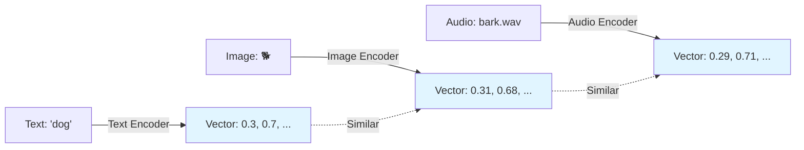
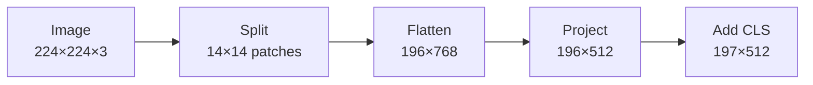
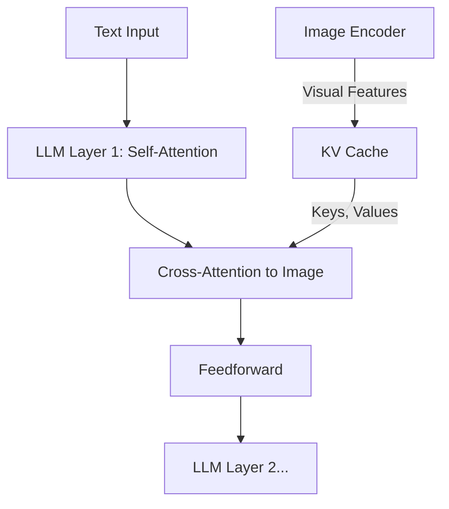
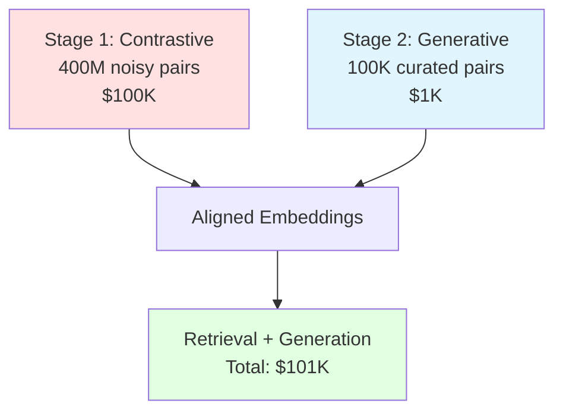
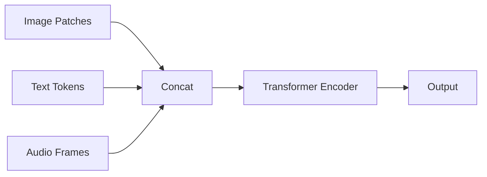
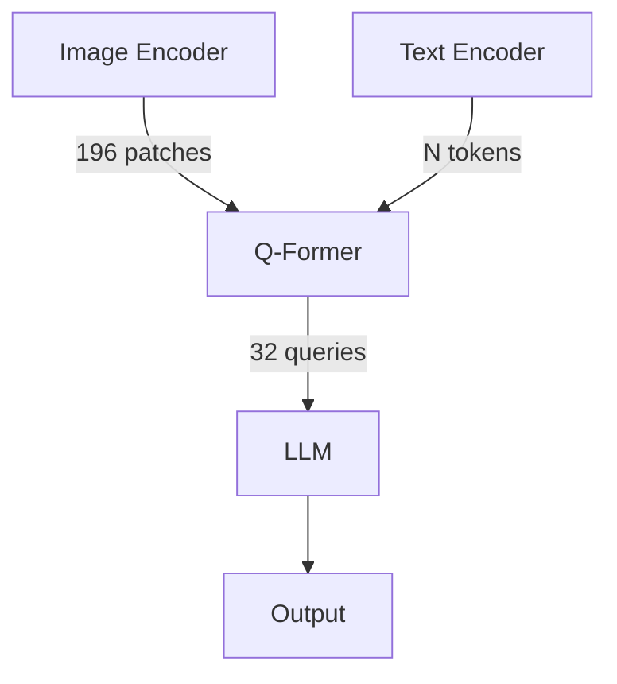

Modern AI systems don't just read text—they process images, audio, video, and combinations of all four. Search for products using photos. Generate captions from videos. Ask questions about charts. Behind all these capabilities lies one fundamental concept: **multimodal embeddings**.

This guide explains how embeddings work across modalities, how they're aligned to understand relationships, and how to build systems that combine them reliably.

<Callout type="info" title="What You'll Learn">
- How embeddings represent different data types (text, images, audio, video)
- Three strategies for aligning modalities (contrastive, generative, hybrid)
- Common fusion patterns with architectural diagrams
- Three runnable examples: image retrieval, captioning, and audio-text search
</Callout>

## The Core Problem

Imagine you're building an image search engine that accepts text queries. Your text encoder outputs vectors of dimension 768. Your image encoder outputs vectors of dimension 1024. Even if you force them to the same dimension, there's no guarantee "photo of a cat" lands near an actual cat image in vector space.

**The challenge:** Making embeddings from different modalities (text, image, audio) **compatible** so that semantically similar content—regardless of format—maps to nearby points in space.

**Why it matters:** Without alignment, cross-modal retrieval fails. An image of a dog won't match the query "golden retriever," and a video of waves won't match "ocean sounds."

<Callout type="warning">
Misaligned embeddings make cross-modal search impossible. Your text and image encoders might as well be speaking different languages.
</Callout>

## How Embeddings Work: A Quick Primer

An **embedding** is a dense numerical vector that represents data in continuous space. Think of it as coordinates in a high-dimensional map where semantic meaning determines location.

**Example:** The sentence "I love cats" might become the vector `[0.2, -0.8, 0.5, ...]` with 512 dimensions. A similar sentence "I adore cats" would map to nearby coordinates like `[0.3, -0.7, 0.4, ...]`, while "I hate dogs" would be far away.

In a well-trained embedding space:
- **Similar items cluster together:** `cosine_similarity("cat", "kitten") ≈ 0.8`
- **Dissimilar items separate:** `cosine_similarity("cat", "airplane") ≈ 0.1`
- **Semantic relationships are preserved:** `king - man + woman ≈ queen`

For **text**, embeddings are learned through language modeling. For **multimodal systems**, we extend this to images, audio, and video by training encoders that project different modalities into **shared or compatible embedding spaces**.



## Step 1: Building Embeddings for Each Modality

Different data types require different preprocessing before becoming embeddings.

### Text: Tokenize, Embed, Position

Text is split into tokens (subwords), mapped to vectors, and enriched with positional information.

**Real-world example:** The sentence "The cat sat" becomes:
1. **Tokenization:** `["The", "cat", "sat"]` → token IDs `[234, 567, 890]`
2. **Token embedding:** Each ID maps to a 512-dim vector
3. **Positional encoding:** Add position info: `[pos=0, pos=1, pos=2]`
4. **Result:** 3 vectors of 512 dimensions each

```python
import torch
import torch.nn as nn

class TextEmbedding(nn.Module):
    def __init__(self, vocab_size=50000, embed_dim=512, max_len=512):
        super().__init__()
        self.token_embed = nn.Embedding(vocab_size, embed_dim)
        self.pos_embed = nn.Embedding(max_len, embed_dim)

    def forward(self, token_ids):
        # token_ids: [batch, seq_len]
        positions = torch.arange(token_ids.size(1), device=token_ids.device)
        return self.token_embed(token_ids) + self.pos_embed(positions)
```

**Key insight:** Positional encodings tell the model where each word appears in the sentence, preserving order.

### Images: Patches as Tokens

Following Vision Transformer (ViT) [5], images are split into fixed-size patches (e.g., 16×16 pixels), flattened, and projected into embeddings.

**Real-world example:** A 224×224 image with 16×16 patches:
1. **Split into patches:** `(224÷16) × (224÷16) = 14 × 14 = 196 patches`
2. **Flatten each patch:** `16×16×3 = 768 values per patch`
3. **Linear projection:** 768 → 512 dimensions
4. **Add [CLS] token + positions:** 197 total tokens (1 CLS + 196 patches)
5. **Result:** 197 vectors of 512 dimensions



```python
class ImagePatchEmbedding(nn.Module):
    def __init__(self, img_size=224, patch_size=16, embed_dim=512, channels=3):
        super().__init__()
        self.num_patches = (img_size // patch_size) ** 2

        # Convolutional projection (faster than flatten + linear)
        self.proj = nn.Conv2d(channels, embed_dim,
                             kernel_size=patch_size, stride=patch_size)

        # Special [CLS] token for classification
        self.cls_token = nn.Parameter(torch.zeros(1, 1, embed_dim))

        # 2D positional embeddings
        self.pos_embed = nn.Parameter(torch.zeros(1, 1 + self.num_patches, embed_dim))

    def forward(self, images):
        # images: [batch, 3, 224, 224]
        x = self.proj(images)  # [batch, embed_dim, 14, 14]
        x = x.flatten(2).transpose(1, 2)  # [batch, 196, embed_dim]

        # Add CLS token
        cls_tokens = self.cls_token.expand(x.size(0), -1, -1)
        x = torch.cat([cls_tokens, x], dim=1)

        return x + self.pos_embed
```

**Key insight:** Images become sequences of patch embeddings, compatible with Transformer architectures designed for text.

### Audio: Convolutional Frame Encoding

Audio waveforms are processed with 1D convolutions to extract temporal features, inspired by wav2vec 2.0 [6].

```python
class AudioEmbedding(nn.Module):
    def __init__(self, embed_dim=512):
        super().__init__()
        # Stack of 1D convolutions over raw waveform
        self.conv_layers = nn.Sequential(
            nn.Conv1d(1, 128, kernel_size=10, stride=5),
            nn.ReLU(),
            nn.Conv1d(128, 256, kernel_size=8, stride=4),
            nn.ReLU(),
            nn.Conv1d(256, embed_dim, kernel_size=4, stride=2),
        )
        self.pos_embed = nn.Parameter(torch.zeros(1, 1024, embed_dim))

    def forward(self, waveform):
        # waveform: [batch, 1, samples]
        x = self.conv_layers(waveform)  # [batch, embed_dim, frames]
        x = x.transpose(1, 2)  # [batch, frames, embed_dim]
        return x + self.pos_embed[:, :x.size(1), :]
```

**Key insight:** Convolutions extract local patterns (phonemes, pitch changes), then positional embeddings add temporal structure.

### Video: Space + Time

Videos extend images with a temporal dimension. Simple approach: embed each frame independently, then add temporal positional encodings.

```python
class VideoEmbedding(nn.Module):
    def __init__(self, img_size=224, patch_size=16, num_frames=8, embed_dim=512):
        super().__init__()
        self.image_embed = ImagePatchEmbedding(img_size, patch_size, embed_dim)
        self.temporal_pos_embed = nn.Parameter(torch.zeros(1, num_frames, embed_dim))

    def forward(self, video):
        # video: [batch, num_frames, 3, H, W]
        batch, frames = video.size(0), video.size(1)

        # Embed each frame
        frame_embeds = []
        for t in range(frames):
            frame_embeds.append(self.image_embed(video[:, t]))

        x = torch.stack(frame_embeds, dim=1)  # [batch, frames, patches+1, dim]

        # Add temporal position to CLS tokens
        x[:, :, 0, :] += self.temporal_pos_embed[:, :frames, :]
        return x.flatten(1, 2)
```

**Key insight:** Video = spatial patches (from images) + temporal positions (from audio/text).

<Callout type="tip" title="Progressive Complexity">
Notice the pattern: text → images → audio → video. Each modality builds on concepts from simpler ones (tokens, patches, convolutions, time).
</Callout>

## Step 2: Projecting Into a Shared Space

Raw embeddings from different encoders live in incompatible spaces. You need to **adapt** them before combining. Three common strategies:

### Strategy 1: Linear Projection (Simplest)

Project modality-specific embeddings into a target dimension (usually the LLM's embedding size).

```python
# Example: Map 768-dim image features to 2048-dim LLM space
image_features = vision_encoder(image)  # [batch, 197, 768]
projection = nn.Linear(768, 2048)
llm_embeds = projection(image_features)  # [batch, 197, 2048]
```

**When to use:**
- Simple adapters and LoRA-style tuning
- Proof-of-concepts and rapid prototyping
- When you have sufficient context window for all tokens

**Trade-offs:**
- ✅ **Fast:** Single matrix multiplication, minimal overhead
- ✅ **Parameter-efficient:** Only adds ~1.5M parameters (768×2048)
- ❌ **No compression:** All 197 image tokens passed to LLM
- ❌ **Limited expressiveness:** Linear transformation only

**Real numbers:** For GPT-3 (context=2048), one image uses ~10% of your context budget.

### Strategy 2: Query-Based Resampler (Q-Former)

Compress variable-length inputs into a fixed number of learned query tokens using cross-attention. Introduced by BLIP-2 [2].

```python
class QFormer(nn.Module):
    def __init__(self, num_queries=32, embed_dim=768, num_heads=12, depth=6):
        super().__init__()
        self.queries = nn.Parameter(torch.zeros(1, num_queries, embed_dim))

        self.layers = nn.ModuleList([
            nn.ModuleDict({
                'cross_attn': nn.MultiheadAttention(embed_dim, num_heads),
                'ffn': nn.Sequential(
                    nn.Linear(embed_dim, 4 * embed_dim),
                    nn.GELU(),
                    nn.Linear(4 * embed_dim, embed_dim)
                )
            }) for _ in range(depth)
        ])

    def forward(self, image_features):
        # image_features: [batch, num_patches, embed_dim]
        batch_size = image_features.size(0)
        queries = self.queries.expand(batch_size, -1, -1)

        for layer in self.layers:
            # Queries attend to image features (compress information)
            attn_out, _ = layer['cross_attn'](
                queries.transpose(0, 1),
                image_features.transpose(0, 1),
                image_features.transpose(0, 1)
            )
            queries = queries + attn_out.transpose(0, 1)
            queries = queries + layer['ffn'](queries)

        return queries  # [batch, 32, embed_dim] - compressed!
```

**When to use:**
- Integrating frozen vision encoders with frozen LLMs
- When context window is limited (long videos, multiple images)
- Production systems optimizing for inference cost

**Trade-offs:**
- ✅ **Compression:** 197 tokens → 32 tokens (6× reduction)
- ✅ **Works with frozen models:** Only Q-Former is trainable
- ✅ **Fixed cost:** Always 32 tokens regardless of input size
- ❌ **More parameters:** Adds ~12M parameters (Q-Former weights)
- ❌ **Information bottleneck:** May lose fine-grained visual details

**Real numbers:** BLIP-2 reduces 197 image tokens to 32, saving ~84% of context window. For 8-frame video: 1,568 → 32 tokens (98% reduction!)


### Strategy 3: Cross-Attention Layers (Flamingo)

Interleave cross-attention layers in the LLM that attend to image/video features. No compression—preserves fine-grained details.



**When to use:**
- Fine-grained visual reasoning (counting objects, reading text in images)
- When quality matters more than inference cost
- Custom model architectures (can't use off-the-shelf LLMs)

**Trade-offs:**
- ✅ **Best quality:** No information loss, full visual detail preserved
- ✅ **Dynamic attention:** LLM decides which visual features to use
- ✅ **Scales to long sequences:** Linear complexity in visual tokens
- ❌ **Requires architectural changes:** Can't use frozen LLMs
- ❌ **Higher training cost:** Must train cross-attention layers

**Real numbers:** Flamingo's 80B model achieves state-of-the-art on VQA, but training costs ~10× more than BLIP-2's approach.

<Callout type="success" title="Quick Decision Guide">

**Choose Linear Projection if:**
- Building a prototype or proof-of-concept
- You have plenty of context window (>8k tokens)
- You need something working in hours, not days

**Choose Q-Former if:**
- Deploying to production with cost constraints
- Processing videos or multiple images per query
- You want to use pretrained frozen models (CLIP + GPT)

**Choose Cross-Attention if:**
- Quality is paramount (fine-grained VQA, OCR)
- You're building a custom architecture from scratch
- You have the compute budget for full model training
</Callout>

## Step 3: Aligning Modalities

Projection alone doesn't create alignment. You need **training objectives** that teach the model which image-text-audio combinations belong together.

### Approach 1: Contrastive Learning (CLIP)

Maximize similarity for matching pairs, minimize for non-matching pairs. CLIP [1] uses InfoNCE loss:

```text
L = -log( exp(sim(I_i, T_i) / τ) / Σ(j=1 to N) exp(sim(I_i, T_j) / τ) )
```

Where `sim` = cosine similarity, `τ` = temperature (typically 0.07).

```python
import torch.nn.functional as F

def contrastive_loss(image_embeds, text_embeds, temperature=0.07):
    # Normalize to unit sphere
    image_embeds = F.normalize(image_embeds, dim=-1)
    text_embeds = F.normalize(text_embeds, dim=-1)

    # Cosine similarity matrix
    logits = (image_embeds @ text_embeds.t()) / temperature

    # Diagonal elements = positive pairs
    labels = torch.arange(len(logits), device=logits.device)

    # Symmetric loss
    loss_i2t = F.cross_entropy(logits, labels)
    loss_t2i = F.cross_entropy(logits.t(), labels)
    return (loss_i2t + loss_t2i) / 2
```

**Best for:**
- Image-text retrieval (search engines, recommendation systems)
- Zero-shot classification ("Is this a cat or dog?")
- Similarity search at scale (billions of images)

**Advantages:**
- ✅ **Scalable:** Trains on noisy web data (no manual labeling)
- ✅ **Fast:** No autoregressive generation needed
- ✅ **Symmetric:** Works for text→image AND image→text

**Limitations:**
- ❌ **No generation:** Can't produce captions or answer questions
- ❌ **Requires large batches:** Needs 256-1024 samples per batch for good negatives
- ❌ **Sensitive to temperature:** `τ` tuning is critical

**Real numbers:** CLIP trained on 400M image-text pairs with batch size 32,768 on 256 GPUs for 12 days. Total cost: ~$100K.

### Approach 2: Generative Objectives

Train the model to generate text conditioned on images (captioning, VQA).

```text
L = -Σ(t=1 to T) log P(w_t | w_<t, I)
```

Standard language modeling loss, but conditioned on visual features.

```python
def generative_loss(image_features, captions, model, tokenizer):
    # Tokenize captions
    inputs = tokenizer(captions, return_tensors="pt", padding=True)

    # Forward pass with image conditioning
    outputs = model(
        input_ids=inputs.input_ids,
        attention_mask=inputs.attention_mask,
        image_features=image_features,
    )

    # Next-token prediction loss
    shift_logits = outputs.logits[:, :-1, :]
    shift_labels = inputs.input_ids[:, 1:]
    shift_labels = shift_labels.masked_fill(inputs.attention_mask[:, 1:] == 0, -100)

    return F.cross_entropy(
        shift_logits.reshape(-1, shift_logits.size(-1)),
        shift_labels.reshape(-1),
        ignore_index=-100
    )
```

**Best for:**
- Image/video captioning ("A golden retriever playing in the park")
- Visual question answering ("How many people are in this photo?")
- Instruction-following multimodal assistants (GPT-4V, Gemini)

**Advantages:**
- ✅ **Generates text:** Produces natural language descriptions
- ✅ **Task-flexible:** Single model handles captioning, VQA, dialogue
- ✅ **Fine-grained understanding:** Learns detailed image-text relationships

**Limitations:**
- ❌ **Needs quality data:** Requires clean image-caption pairs (not just alt-text)
- ❌ **Expensive training:** Autoregressive generation is slow
- ❌ **Not symmetric:** Primarily image→text (can't do text→image retrieval well)

**Real numbers:** LLaVA trained on 158K GPT-4V-generated captions on 8× A100s for 4 hours. Total cost: ~$1K for data + ~$500 for compute.

### Approach 3: Hybrid (Best of Both Worlds)

Modern systems use a two-stage pipeline:

1. **Stage 1:** Contrastive pretraining on massive noisy data (web-scraped image-text pairs)
2. **Stage 2:** Generative fine-tuning on curated instruction data

**Examples:** BLIP-2 [2], LLaVA, Qwen-VL.

**Why it works:** Contrastive learning provides cheap, scalable alignment. Generative tuning adds language generation and instruction-following.

<Callout type="info">
**Cost Comparison:**
- **Contrastive-only (CLIP):** $100K training, great for retrieval, can't generate
- **Generative-only:** $100K+ training, can generate, poor retrieval
- **Hybrid (BLIP-2/LLaVA):** $100K Stage 1 + $1K Stage 2 = **best of both worlds**

The hybrid approach gets you 90% of generative quality at 1% of the cost by reusing CLIP's pretrained embeddings.
</Callout>



## Step 4: Fusion Patterns

How do you combine embeddings from multiple modalities in practice?

Here's a quick comparison of the three main patterns:

| Pattern | Token Count | Complexity | Best For | Example |
|---------|-------------|------------|----------|---------|
| **Early Fusion** | Sum of all modalities | O(n²) where n=total | Simple tasks, small inputs | Image (196) + Text (50) = 246 tokens |
| **Cross-Attention** | Text tokens only | O(n×m) | Fine-grained reasoning | Text (50) attends to Image (196) |
| **Latent Queries** | Fixed (32-64) | O(1) | Videos, multiple images | 8 frames (1,568) → 32 tokens |

### Pattern 1: Early Fusion (Concatenate)

Concatenate all modality embeddings, pass to a unified Transformer.



```python
def early_fusion(image_embeds, text_embeds, audio_embeds):
    # All: [batch, seq_len, dim]
    combined = torch.cat([image_embeds, text_embeds, audio_embeds], dim=1)
    return transformer_encoder(combined)
```

**Pros:**
- ✅ Simple to implement
- ✅ Cross-modal attention at every layer
- ✅ No information loss

**Cons:**
- ❌ Quadratic complexity: O((196+50)²) = 60K operations
- ❌ Doesn't scale: 8-frame video = 1,618 tokens = 2.6M operations
- ❌ Wastes context: Visual tokens compete with text for attention

**When to use:** Single image + short text (< 100 tokens total), research prototypes

### Pattern 2: Cross-Attention Fusion (Flamingo)

Text attends to visual features via dedicated cross-attention layers.

```python
class CrossAttentionFusion(nn.Module):
    def __init__(self, dim=768, num_heads=12):
        super().__init__()
        self.cross_attn = nn.MultiheadAttention(dim, num_heads)
        self.norm = nn.LayerNorm(dim)

    def forward(self, text_embeds, visual_embeds):
        # Queries from text, keys/values from vision
        attn_out, _ = self.cross_attn(
            text_embeds.transpose(0, 1),
            visual_embeds.transpose(0, 1),
            visual_embeds.transpose(0, 1)
        )
        return self.norm(text_embeds + attn_out.transpose(0, 1))
```

**Pros:**
- ✅ Linear complexity: O(50 × 196) = 9.8K operations (6× better than early fusion)
- ✅ Modality-specific processing preserved
- ✅ Scales to videos: O(text_len × visual_len)

**Cons:**
- ❌ Requires modifying LLM architecture
- ❌ Can't use fully frozen models
- ❌ More complex training setup

**When to use:** Custom architectures, production systems with long videos, when quality > training cost

### Pattern 3: Latent Query Tokens (Q-Former)

Learned queries compress and fuse multimodal information.



**Pros:**
- ✅ Fixed compute: Always 32 tokens regardless of input (1 image vs 100 images)
- ✅ Works with frozen models: CLIP + GPT-3 stay frozen
- ✅ Massive compression: 1,568 video tokens → 32 (98% reduction)

**Cons:**
- ❌ Information bottleneck: May lose fine-grained details (small text, precise counts)
- ❌ Adds training complexity: Need to train Q-Former separately

**When to use:** Production systems, cost-sensitive deployments, processing videos or multiple images

**Real-world performance:** BLIP-2 with 32 queries achieves 95% of Flamingo's VQA accuracy at 10% of the inference cost.

## Practical Examples

### Example 1: Zero-Shot Image Retrieval with CLIP

Retrieve images using text queries without task-specific training.

```python
# Install: pip install transformers torch pillow requests
from transformers import CLIPProcessor, CLIPModel
from PIL import Image
import torch
import requests

# Load pretrained CLIP
model = CLIPModel.from_pretrained("openai/clip-vit-base-patch32")
processor = CLIPProcessor.from_pretrained("openai/clip-vit-base-patch32")

# Load images
url1 = "http://images.cocodataset.org/val2017/000000039769.jpg"
url2 = "http://images.cocodataset.org/val2017/000000001584.jpg"
image1 = Image.open(requests.get(url1, stream=True).raw).convert("RGB")
image2 = Image.open(requests.get(url2, stream=True).raw).convert("RGB")

# Text queries
texts = ["two cats on a couch", "a person on a skateboard", "a dog"]

# Encode
inputs = processor(text=texts, images=[image1, image2],
                   return_tensors="pt", padding=True)

with torch.no_grad():
    outputs = model(**inputs)
    image_embeds = outputs.image_embeds  # [2, 512]
    text_embeds = outputs.text_embeds    # [3, 512]

    # Compute similarity
    similarity = (image_embeds @ text_embeds.t()) * model.logit_scale.exp()
    probs = similarity.softmax(dim=1)

print("Image-to-text similarity:")
print(probs)
# Output: image1 → "two cats on a couch" (high prob)
#         image2 → "a person on a skateboard" (high prob)
```

**Key takeaway:** CLIP's contrastive training enables zero-shot retrieval. No fine-tuning needed.

<Callout type="info">
**Running on GPU:** Add `model = model.to("cuda")` and `inputs = {k: v.to("cuda") for k, v in inputs.items()}` for 10-100× speedup.
</Callout>

### Example 2: Image Captioning with Q-Former (Pseudo-Code)

Shows the BLIP-2 [2] architecture: Q-Former compresses visual info for an LLM.

```python
class ImageCaptioningModel(nn.Module):
    def __init__(self, vision_encoder, llm, num_queries=32):
        super().__init__()
        self.vision_encoder = vision_encoder  # Frozen ViT
        self.qformer = QFormer(num_queries=32, embed_dim=768)
        self.projection = nn.Linear(768, llm.config.hidden_size)
        self.llm = llm  # Frozen LLM (e.g., OPT-2.7B)

    def forward(self, images, caption_ids):
        # Extract visual features (no gradients)
        with torch.no_grad():
            image_features = self.vision_encoder(images).last_hidden_state

        # Compress with Q-Former (trainable)
        queries = self.qformer(image_features)  # [batch, 32, 768]

        # Project to LLM space
        visual_tokens = self.projection(queries)  # [batch, 32, llm_dim]

        # Concatenate with text embeddings
        text_embeds = self.llm.get_input_embeddings()(caption_ids)
        inputs_embeds = torch.cat([visual_tokens, text_embeds], dim=1)

        # Prepare labels (ignore visual token positions)
        visual_labels = torch.full(
            (caption_ids.size(0), 32), -100, device=caption_ids.device
        )
        labels = torch.cat([visual_labels, caption_ids], dim=1)

        # Generate caption
        outputs = self.llm(inputs_embeds=inputs_embeds, labels=labels)
        return outputs.loss

# Training: Only Q-Former + projection are trained (efficient!)
# model = ImageCaptioningModel(frozen_vit, frozen_opt)
# loss = model(images, caption_ids)
```

**Key takeaway:** Q-Former is the "bridge" between frozen vision and language models. Cheap to train (~12M params), enables powerful captioning.

### Example 3: Audio-Text Retrieval (ImageBind-Inspired)

ImageBind [4] aligns 6 modalities using images as a "hub." Here's a simplified audio-text version.

```python
# Install: pip install torch transformers
import torch
import torch.nn as nn
import torch.nn.functional as F
from transformers import CLIPModel, CLIPProcessor

# Toy audio encoder (in practice, use pretrained wav2vec2)
class AudioEncoder(nn.Module):
    def __init__(self, output_dim=512):
        super().__init__()
        self.conv = nn.Conv1d(1, 128, kernel_size=10, stride=5)
        self.pool = nn.AdaptiveAvgPool1d(1)
        self.fc = nn.Linear(128, output_dim)

    def forward(self, waveform):
        x = F.relu(self.conv(waveform))
        x = self.pool(x).squeeze(-1)
        return F.normalize(self.fc(x), dim=-1)

# Load CLIP for text encoding
clip = CLIPModel.from_pretrained("openai/clip-vit-base-patch32")
processor = CLIPProcessor.from_pretrained("openai/clip-vit-base-patch32")
audio_encoder = AudioEncoder(output_dim=512)

# Mock audio clips (1 second at 16kHz)
audio_clips = [torch.randn(1, 1, 16000) for _ in range(3)]
text_queries = ["dog barking", "ocean waves", "car engine"]

# Encode
audio_embeds = torch.cat([audio_encoder(clip) for clip in audio_clips])
text_inputs = processor(text=text_queries, return_tensors="pt", padding=True)
text_embeds = clip.get_text_features(**text_inputs)

# Similarity search
similarity = audio_embeds @ text_embeds.t()
print("Audio-text similarity matrix:")
print(similarity)
# Diagonal should be highest if aligned correctly
```

**Key takeaway:** By training audio and text encoders with shared image anchors (ImageBind's approach), you can retrieve audio using text—even without direct audio-text pairs.

## Common Pitfalls and Solutions

### Problem 1: Token Explosion ("My context window is full!")

**Symptom:** Model crashes with "Sequence length exceeds maximum (2048)" after adding 2-3 images.

**Root cause:** Each 224×224 image = 197 tokens. 10 images = 1,970 tokens, leaving only 78 for text.

**Solutions (pick based on your constraints):**

| Solution | Token Reduction | Quality Impact | Implementation |
|----------|----------------|----------------|----------------|
| **Q-Former** | 197 → 32 (84%) | Minimal (&lt;5%) | Use BLIP-2 architecture |
| **Spatial pooling** | 197 → 49 (75%) | Low (~10%) | Average 2×2 patches |
| **Cross-attention** | 0 (stored separately) | None | Modify LLM architecture |
| **Resize images** | 224²→112² = 49 tokens | Moderate (~20%) | Smaller patch size |

**Quick fix:** Use BLIP-2's Q-Former. It's pretrained and works out-of-the-box.

### Problem 2: Forgetting to Normalize ("Similarity scores are all over the place!")

**Symptom:** Text→image similarity returns values like `[-127.3, 0.002, 45.8]` instead of `[0.1, 0.8, 0.3]`.

**Root cause:** Image encoder outputs vectors with L2 norm = 23.4, text encoder outputs norm = 0.8. Dot product scales unpredictably.

**Solution:** Always L2-normalize to unit sphere before computing similarity.

```python
# ❌ WRONG: Unnormalized dot product
similarity = image_embeds @ text_embeds.t()  # Range: [-∞, +∞]

# ✅ CORRECT: Normalize first
image_embeds = F.normalize(image_embeds, dim=-1)  # L2 norm = 1.0
text_embeds = F.normalize(text_embeds, dim=-1)    # L2 norm = 1.0
similarity = image_embeds @ text_embeds.t()       # Range: [-1, 1]
```

**Why it matters:** CLIP, ImageBind, and all modern multimodal models normalize. If you don't, retrieval breaks completely.

**Pro tip:** Add an assertion during development:
```python
assert torch.allclose(image_embeds.norm(dim=-1), torch.ones(len(image_embeds)))
```

### Problem 3: Catastrophic Forgetting ("My LLM forgot how to write!")

**Symptom:** After multimodal fine-tuning, GPT-3's text generation quality drops from 8/10 to 4/10.

**Root cause:** Updating all 175B parameters on image-text data overwrites language-only knowledge.

**Diagnosis:**
```python
# Before multimodal training
text_only_perplexity = 12.3  # Good

# After full fine-tuning on image-text pairs
text_only_perplexity = 45.7  # Bad! Language degraded
```

**Solutions (ranked by effectiveness):**

1. **Freeze the LLM, train only adapters** (BLIP-2 approach)
   - Keep LLM frozen, train Q-Former + projection only
   - Preserves 100% of language performance
   - Cost: ~12M trainable params

2. **Use LoRA** (parameter-efficient tuning)
   - Add low-rank matrices: `W' = W + AB` where A, B are small
   - Updates &lt;1% of parameters
   - Cost: ~4M params for 175B model

3. **Mix text-only data during training** (20% text, 80% multimodal)
   - Prevents forgetting by continual language modeling
   - Increases training cost by 20%

**Recommended:** Start with frozen LLM + trainable Q-Former. Only use LoRA if you need the LLM to learn new visual concepts.

### Problem 4: Dataset Bias ("My model has problematic associations!")

**Symptom:** Image search for "CEO" returns 95% male photos. "Nurse" returns 90% female.

**Root cause:** Web-scraped image-text pairs reflect societal biases. LAION-400M (used by CLIP) inherits these biases.

**Real example:**
```python
# Biased associations learned from web data
model.similarity("CEO photo", male_images)    # 0.78 average
model.similarity("CEO photo", female_images)  # 0.43 average
```

**Solutions (layered approach):**

1. **Audit before deploying** (mandatory)
   - Test on FairFace, UTKFace datasets (balanced demographics)
   - Measure Recall@K across gender, race, age groups
   - Set minimum thresholds (e.g., &lt;10% disparity between groups)

2. **Re-caption with better models** (reduce bias at source)
   - Use GPT-4V to generate neutral captions
   - Example: "Person in business attire" instead of "Businessman"
   - Cost: ~$0.01 per image × 100K images = $1K

3. **Curate instruction datasets** (controlled fine-tuning)
   - LLaVA-Instruct: 158K human-reviewed examples
   - Filters out toxic content and stereotypes
   - Improves both quality and fairness

4. **Evaluate on diverse benchmarks**
   - Test multiple languages (not just English)
   - Cover different domains (medical, legal, creative)
   - Track subgroup performance separately

<Callout type="warning">
Always audit for bias before deploying. Multimodal models inherit biases from both vision and language pretraining.
</Callout>

## Production Checklist

Before shipping multimodal features:

- [ ] Embeddings are L2-normalized before similarity computations
- [ ] Token counts per modality fit within context window
- [ ] Alignment quality validated on retrieval benchmarks (Recall@K)
- [ ] Inference latency measured end-to-end (including encoding)
- [ ] Bias evaluated across key user demographics
- [ ] Monitoring detects embedding drift (track similarity on anchor set)
- [ ] Fallbacks exist for modality-specific failures (e.g., corrupted images)

## Best Practices from Production Systems

1. **Start with pretrained backbones.** Don't train vision/text encoders from scratch. Use CLIP, ViT, or LLaMA.

2. **Iterate on alignment objectives.** Prototype with contrastive learning (fast), then add generative tuning if you need captioning.

3. **Profile token budgets early.** Monitor tokens per modality. Use resamplers if you exceed context windows.

4. **Validate on simple tasks first.** Test text→image retrieval before building complex VQA systems. Simpler tasks expose alignment issues faster.

5. **Version datasets rigorously.** Track which data mixtures produced each checkpoint. Multimodal training is sensitive to data distribution shifts.

6. **Benchmark against unimodal baselines.** Always compare against CLIP (vision) and GPT (text) to quantify multimodal gains.

7. **Monitor inference costs.** Cross-attention and Q-Formers add overhead. Benchmark latency early to avoid production surprises.

## Key Metrics to Track

**Retrieval Quality:**
- Text→image Recall@1, Recall@5
- Image→text Recall@1, Recall@5
- Audio→text Recall@K

**Generation Quality:**
- CIDEr, BLEU (captioning)
- Accuracy (VQA)
- Human preference scores (instruction-following)

**System Health:**
- Embedding drift (similarity on fixed anchor set)
- Inference latency (P50, P95, P99)
- GPU memory footprint
- Cost per query

**Safety:**
- Bias metrics across demographics
- Harmful content detection rates
- Adversarial robustness

<Callout type="success" title="Start Small, Iterate Fast">
Pick one example from this guide, run it end-to-end, then swap in your own data. Measure retrieval accuracy or generation quality. Real data beats theory every time.
</Callout>

## References

[1] Radford, A., et al. (2021). Learning transferable visual models from natural language supervision. *ICML 2021*. [arXiv:2103.00020](https://arxiv.org/abs/2103.00020)

[2] Li, J., et al. (2023). BLIP-2: Bootstrapping language-image pre-training with frozen encoders and LLMs. *ICML 2023*. [arXiv:2301.12597](https://arxiv.org/abs/2301.12597)

[3] Alayrac, J.-B., et al. (2022). Flamingo: A visual language model for few-shot learning. *NeurIPS 2022*. [arXiv:2204.14198](https://arxiv.org/abs/2204.14198)

[4] Girdhar, R., et al. (2023). ImageBind: One embedding space to bind them all. *CVPR 2023*. [arXiv:2305.05665](https://arxiv.org/abs/2305.05665)

[5] Dosovitskiy, A., et al. (2021). An image is worth 16x16 words: Transformers for image recognition at scale. *ICLR 2021*. [arXiv:2010.11929](https://arxiv.org/abs/2010.11929)

[6] Baevski, A., et al. (2020). wav2vec 2.0: A framework for self-supervised learning of speech representations. *NeurIPS 2020*. [arXiv:2006.11477](https://arxiv.org/abs/2006.11477)

[7] Chen, X., et al. (2022). PaLI: A jointly-scaled multilingual language-image model. [arXiv:2209.06794](https://arxiv.org/abs/2209.06794)

[8] Liang, P., Zadeh, A., & Morency, L.-P. (2022). Foundations and trends in multimodal machine learning. [arXiv:2209.03430](https://arxiv.org/abs/2209.03430)

[9] Jaegle, A., et al. (2021). Perceiver IO: A general architecture for structured inputs & outputs. *ICML 2021*. [arXiv:2107.14795](https://arxiv.org/abs/2107.14795)

[10] Han, X., et al. (2023). Self-supervised multimodal learning: A survey. [arXiv:2304.01008](https://arxiv.org/abs/2304.01008)

## Further Reading

**Google Cloud Resources:**
- [Multimodal embeddings on Vertex AI](https://cloud.google.com/vertex-ai/generative-ai/docs/embeddings/get-multimodal-embeddings)
- [Visual search with multimodal embeddings](https://developers.googleblog.com/en/see-the-similarity-personalizing-visual-search-with-multimodal-embeddings/)
- [BigQuery multimodal embeddings](https://cloud.google.com/blog/products/data-analytics/bigquery-multimodal-embeddings-generation)

**Libraries:**
- `transformers` — Pretrained multimodal models (CLIP, BLIP, Flamingo)
- `open_clip` — CLIP training recipes and model zoo
- `timm` — Vision backbones (ViT, ConvNeXt, etc.)
- `faiss`, `milvus`, `qdrant` — Vector search at scale
